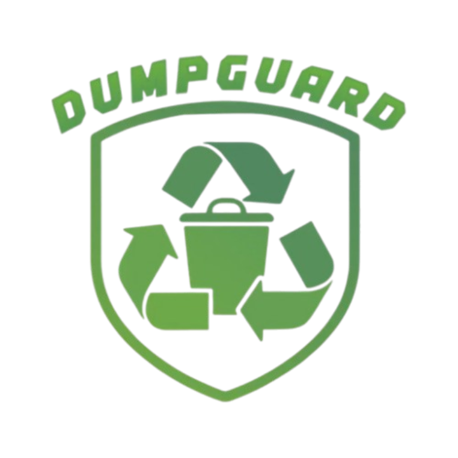

<div align="center">



# DumpGuard NJ

**From confusion to a cleaner community.**

Built by Saanvika Govindaraj, Vedant Daga and Nethra Ramkumar<br>
for the Congressional App Challenge 2026, District NJ-06

<table>
  <tr><td><b>Live site</b></td><td><a href="https://dumpguard.vercel.app">dumpguard.vercel.app</a></td></tr>
  <tr><td><b>Android</b></td><td><code>.apk</code> on the <a href="../../releases">Releases</a> page</td></tr>
  <tr><td><b>iOS</b></td><td>Install the website as a PWA</td></tr>
  <tr><td><b>Languages</b></td><td>English and Spanish</td></tr>
</table>

</div>

---

DumpGuard helps people in New Jersey, mainly the 6th Congressional District, figure out recycling and waste disposal. Something as simple as throwing away a plastic container gets confusing when every town has different rules, so we put what people actually need in one place instead of making them dig through a municipal website.

It answers three questions instantly:

| Question | Feature |
|---|---|
| Can I recycle this? | **Identify** |
| When is my pickup? | **Pickup days** |
| How do I report dumping? | **Report** |

- **Identify.** Point your camera at an item or search by name. A live tracking box follows the item, and the app says whether it's recyclable and what your town says to do with it: recycling, trash, or a special drop-off. If the model isn't sure, it shows the closest matches instead of a confident wrong answer.
- **Pickup days.** Enter an address to see the next trash, recycling, bulk and yard-waste dates. 25 towns match an address to a zone automatically from street lists or zone maps we traced; the other seven use a manual zone picker.
- **Report dumping.** Photograph the site, mark the location, submit, and get a tracking code. Location data is stripped from photos, and the public map only shows clusters of three or more reports.

## How it works

| Layer | What we used |
|---|---|
| Frontend | Plain HTML, CSS and JavaScript, no framework. A service worker makes Identify work offline after the first visit. |
| Backend | Vercel serverless functions (Node) and Postgres. Report photos are stored as bytes after EXIF is stripped. |
| Maps | Leaflet with OpenStreetMap tiles. Nominatim and the Census geocoder turn addresses into locations. |
| Android | The same web app, bundled with Capacitor and built by GitHub Actions. |

## The model

A fine-tuned MobileNetV3 classifier with 7 classes: rigid plastic, soft plastic/foam, cardboard/paper, metal, glass, e-waste/hazard, and no object. Float16 quantization brought the TensorFlow.js export down to about 5.9 MB.

| Split | Accuracy |
|---|---|
| Validation | 85.9% |
| Test (in-distribution) | 82.6% |
| External set | 64.3% |

Rigid plastic is our weakest class at 69% recall; it's sometimes confused with soft plastic or foam.

**Training data:** 39,110 images from TrashNet, TACO, Garbage12, RealWaste, ZeroWaste, TrashBox, Open Images and a curated e-waste set, plus our own scrapes of openly-licensed photos (Openverse, Wikimedia Commons, Pixabay, Pexels) for thinly covered classes. CLIP and OwlViT auto-relabel and clean the raw pull, and perceptual-hash dedup keeps near-duplicates from landing in both training and testing, so the accuracy numbers stay honest.

## The data we collected

- **Town rules and schedules** were read from each town's official calendars and pages and entered by hand over several research passes.
- **Pickup zones** for towns without an official address lookup were traced by hand from township maps into street lists and polygons, then checked against real addresses. Towns we couldn't trace confidently fall back to a zone picker instead of guessing.

## What's next for 2.0

- Improve the model where materials look alike, then test on new images.
- Automatic zone lookup for the remaining seven towns.
- A native-speaker review of the Spanish, which AI helped draft.
- Connect reports to municipal public works and NJDEP's Warn DEP, and add duplicate-report detection.
- Proper inference benchmarks across devices.

## Repo layout

| Path | What it holds |
|---|---|
| `website/` | Web app, service worker, TF.js model (`lib/`), API (`api/`), town data (`data/towns.json`) |
| `android/` | Capacitor Android project |
| `ml-waste-categorizer-model/` | `preprocess.py`, `dataset.py`, `model.py`, `train.py`, `evaluate.py`, `export.py` |
| `.github/workflows/` | Builds and publishes the Android APK |

## Running it

```bash
cd website
npm install
export DATABASE_URL=postgres://...
npm run migrate    # create the schema
npm run seed       # load towns, items, schedules and facilities
```

Android: from `android/`, run `npm install && npm run sync`, then open the project in Android Studio. The model: `cd ml-waste-categorizer-model && python train.py && python export.py`.
