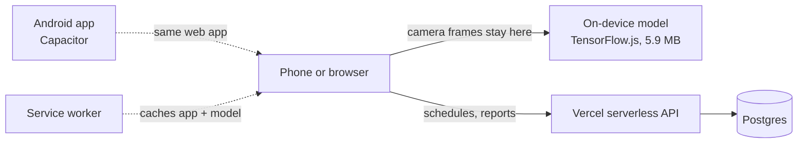
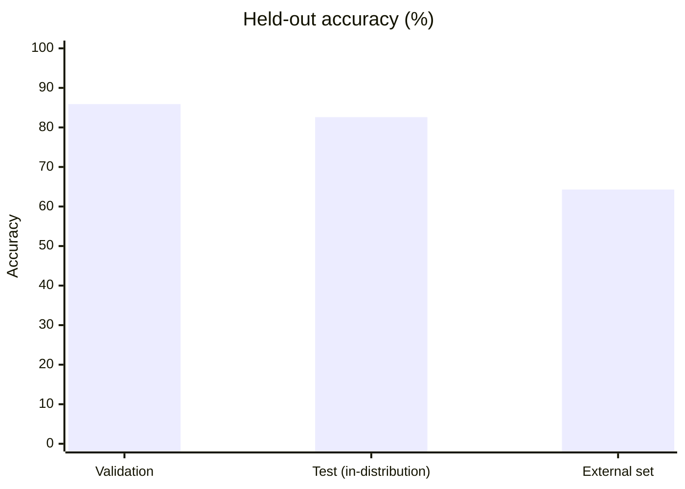

# DumpGuard NJ

**From confusion to a cleaner community.**

DumpGuard is an app we built for people in New Jersey, mainly those living in the 6th Congressional District (NJ-06), to make recycling and waste disposal easier to figure out. Something as simple as throwing away a plastic container can get confusing when every town has different rules. We wanted to put the information people actually need in one place, instead of making them dig through a municipal website every time they have a question.

Built by Saanvika Govindaraj, Vedant Daga and Nethra Ramkumar for the Congressional App Challenge 2026.

| | |
|---|---|
| **Demo video** | https://youtu.be/a2E4sVAGVNg |
| **Live site** | https://dumpguard.vercel.app |
| **Android** | `.apk` on the [Releases](../../releases) page |
| **iOS** | Install the website as a PWA |
| **Languages** | English and Spanish |

---

## The three questions

DumpGuard is built to answer three things instantly, without anyone digging through town websites:

| Question | Feature |
|---|---|
| Can I recycle this? | **Identify** |
| When is my pickup? | **Pickup days** |
| How do I report dumping? | **Report** |

### Identify

Point your camera at an item or search for it by name, and the app gives a clear answer on whether it's recyclable. It then shows what your specific town says to do with it: the recycling bin, the trash, or a special drop-off location. A live tracking box follows the item as you move, cropping tight before the model ever sees a frame.

If the model isn't sure what it's looking at, it says so and shows the closest matches so you can choose, rather than giving a confident but wrong answer.

### Pickup days

Enter your address and see the next trash, recycling, bulk and yard-waste dates for your zone. For 25 towns the app matches an address to the right zone automatically, using municipal street lists or zone maps we traced ourselves. The other seven use a manual zone picker as a backup, since not every municipality publishes this information the same way.

### Report dumping

If you see waste dumped somewhere it shouldn't be, take a picture, mark the location and submit. You get a tracking code to check the status later.

- Location data is stripped from photos before they are stored.
- The public map only displays clusters of three or more reports, never individual ones.

---

## How it works



| Layer | What we used |
|---|---|
| Frontend | Plain HTML, CSS and JavaScript. No framework. |
| Offline | Service worker caches the app and the model, so Identify works with no connection after the first visit. |
| Backend | Vercel serverless functions (Node). |
| Database | Postgres. Town rules, schedules, facilities and reports live here. Report photos are stored as bytes after EXIF is stripped. |
| Maps | Leaflet with OpenStreetMap tiles. Nominatim and the Census geocoder turn addresses into locations. |
| Android | The same web app, bundled with Capacitor and built by GitHub Actions. |

Identification runs on the device, but schedules and dumping reports still need the server. We made those parts work together without pretending everything is available offline.

---

## The model

A fine-tuned MobileNetV3 classifier that sorts an image into 7 classes: rigid plastic, soft plastic/foam, cardboard/paper, metal, glass, e-waste/hazard, and no object. It is exported as a TensorFlow.js graph model, and float16 quantization brought it down to about **5.9 MB** so it loads comfortably on older phones.

### Accuracy



| Split | Accuracy |
|---|---|
| Validation | 85.9% |
| Test, in-distribution | 82.6% |
| External (harder, different sources) | 64.3% |

Our weakest class is rigid plastic at 69% recall; the model sometimes confuses it with soft plastic or foam.

### Training data

39,110 images from public waste-sorting datasets, plus our own openly-licensed scrapes for the classes the public data covered thinly.

| Source | Role |
|---|---|
| TrashNet, TACO, Garbage12, RealWaste, ZeroWaste, TrashBox | Public waste-sorting datasets |
| Open Images | General object images |
| Curated e-waste set | E-waste and hazard class |
| Openverse, Wikimedia Commons, Pixabay, Pexels | Our own scrapes of openly-licensed photos |

Cleaning mattered as much as collecting:

1. **Auto-label and clean.** CLIP and OwlViT relabel the raw pull, crop to the right object and drop bad examples, so we weren't sorting tens of thousands of photos by hand.
2. **Deduplicate.** Perceptual hashing keeps near-duplicate photos from landing in both training and testing, which would make the accuracy numbers look better than they really are.
3. **Train in two phases.** First a new head with the base frozen, then fine-tuning the upper layers with BatchNorm frozen.

---

## The data we collected

| What | How we got it |
|---|---|
| **Town rules and schedules** | Read from each town's official calendars and pages and entered by hand, town by town, over several research passes. The app tells you to confirm with your town wherever a zone is approximate. |
| **Pickup zones** | For towns without an official address lookup, we traced zone boundaries by hand from township maps into street lists and polygons, then checked them against real addresses. Towns we couldn't trace confidently fall back to a plain zone picker instead of guessing. |
| **Training images** | Public datasets plus openly-licensed scrapes, then auto-cleaned (see above). |

Addresses near a zone boundary were the tricky part, since guessing the wrong side shows the wrong pickup dates. That is one reason the manual picker stays.

---

## What was hard

| Problem | What happened |
|---|---|
| Getting the model onto a phone | Our first export was too large and slow to load, and converting from Keras to TensorFlow.js was its own fight. Float16 quantization got it to 5.9 MB. |
| The tracking box | The model is a classifier, not a detector, so it can't say where the item is. We built our own method that scores candidate windows and separates the object from the background by color, then tuned it over many test images after it kept locking onto small patches. |
| Municipal data | Some towns publish street lists, some publish maps, some publish nothing usable. Each needed a different approach. |
| Trustworthy results | Most of the work was making sure the numbers were honest, not just getting features to run. |

---

## What's next for 2.0

| Goal | Why |
|---|---|
| Better image recognition | Add more varied examples of the materials the model mixes up, study its mistakes, retrain, and test on new images rather than assuming more data means better results. |
| Automatic zones in all towns | 25 towns resolve automatically today; the remaining seven need dependable zone data, checked against real streets near boundaries. |
| A native-speaker review of the Spanish | AI helped with a first draft and we reviewed it as carefully as we could, but a native speaker hasn't checked it yet. |
| Reports that reach agencies | Connect submissions to municipal public works and eventually NJDEP's Warn DEP system. |
| Duplicate-report detection | We rate-limit spam, but the app doesn't yet recognize when several people report the same site. |
| Real inference benchmarks | We've tested on real phones, but want proper numbers across devices instead of "it feels fast". |

---

## Repo layout

| Path | What it holds |
|---|---|
| `website/` | The web app, service worker, TF.js model in `lib/`, API in `api/`, town data in `data/` |
| `website/data/towns.json` | Town schedules, facilities, ZIP codes, and each town's street lists or zone polygons |
| `android/` | Capacitor Android project |
| `ml-waste-categorizer-model/` | `preprocess.py`, `dataset.py`, `model.py`, `train.py`, `evaluate.py`, `export.py` |
| `.github/workflows/` | Builds and publishes the Android APK |

## Running it

Web app: serve `website/` with any static server. The API needs a Postgres database.

```bash
cd website
npm install
export DATABASE_URL=postgres://...
npm run migrate    # create the schema
npm run seed       # load towns, items, schedules and facilities
```

Android: from `android/`, run `npm install && npm run sync`, then open the project in Android Studio. The GitHub Actions workflow does the same and publishes a signed APK as a release.

Model:

```bash
cd ml-waste-categorizer-model
python train.py
python export.py
```
